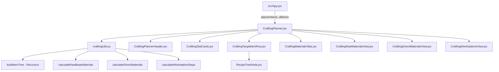

# Módulo de Calculadora y Taller de Crafteo (`src/components/crafting/`)

Módulo modularizado y atomizado para el **Taller y Calculadora de Crafteo Multi-Nivel** de **Dragonwilds**. Permite planificar la fabricación de cualquier objeto o equipamiento desglosando sus recetas de forma recursiva hasta sus materias primas elementales, calculando experiencia total (XP), estaciones de trabajo necesarias y listas de chequeo interactivas con progreso y celebración.

---

## 1. Arquitectura y Responsabilidades

```
src/components/crafting/
├── CraftingPlanner.jsx             # Contenedor orquestador principal del taller de crafteo
├── craftingUtils.js                # Algoritmos puros: resolución de árboles recursivos, materias primas y XP
├── CraftingEmptyState.jsx          # Estado visual vacío cuando no hay ítems en la cesta
├── CraftingPlannerHeader.jsx       # Cabecera con título, badge 'Multi-Nivel', contador y botón vaciar
├── CraftingStatCards.jsx           # Tarjetas métricas (recursos base, bancos de trabajo, XP total)
├── CraftingTargetItemRow.jsx       # Fila de objetivo a fabricar (controles +/- cantidad, eliminar y botón árbol)
├── RecipeTreeNode.jsx              # Nodo recursivo para visualizar el árbol genealógico de ingredientes
├── CraftingMaterialsTabs.jsx       # Selector de modos (Base, Directo, Estaciones) y barra de progreso
├── CraftingRawMaterialsView.jsx    # Vista 1: Lista interactiva de materias primas elementales y propósitos
├── CraftingDirectMaterialsView.jsx # Vista 2: Lista interactiva de ingredientes intermedios de montaje
├── CraftingWorkstationsView.jsx    # Vista 3: Guía paso a paso numerada por estaciones de trabajo
└── README.md                       # Documentación técnica del módulo
```

---

## 2. Mapa de Componentes y Props

### `CraftingPlanner.jsx` (Orquestador)
Contenedor principal que maneja los estados reactivos (`plannerMode`, `checkedRawMaterials`, `checkedDirectMaterials`, `expandedItemTrees`), ejecuta las memorizaciones de cálculo (`useMemo`) y orquesta los subcomponentes.

| Prop | Tipo | Descripción |
| :--- | :--- | :--- |
| `plannerItems` | `Array<{ item: Object, quantity: number }>` | Lista de objetos añadidos al planificador. |
| `onUpdateQuantity` | `Function(itemId: string, newQty: number)` | Callback para actualizar la cantidad deseada de un ítem. |
| `onRemoveItem` | `Function(itemId: string)` | Callback para eliminar un ítem del planificador. |
| `onClearPlanner` | `Function()` | Callback para vaciar completamente la lista. |
| `allItems` | `Array<Object>` | Catálogo completo para resolución recursiva de recetas e iconos. |
| `onSelectItem` | `Function(item: Object)` | Callback para abrir la ficha de detalle de un objeto. |

---

### `craftingUtils.js` (Lógica de Negocio y Algoritmos)
Funciones puras de cálculo matemático y resolución de grafos de recetas:
- **`buildItemMap(allItems)`**: Construye un `Map` indexado por `title`, `name`, `id` y `englishTitle` para búsquedas en tiempo $O(1)$.
- **`findItemByName(itemMap, name)`**: Búsqueda insensible a mayúsculas/minúsculas.
- **`buildItemTree(itemMap, itemName, quantity, visited, depth)`**: Descomposición recursiva de ingredientes con control de ciclos (`visited`), límite de profundidad (máx 8), ratio de rendimiento (`outputQty`) y acumulación de experiencia.
- **`calculateDirectMaterials(plannerItems, itemMap)`**: Materiales de primer nivel para ensamblaje directo.
- **`calculateRawBaseMaterials(fullRecipeTrees)`**: Extracción de hojas elementales con trazabilidad de propósitos (`purposes`) y estaciones requeridas.
- **`calculateWorkstationSteps(fullRecipeTrees)`**: Agrupación secuencial por banco/estación de trabajo (`facility`), calculando tiradas y XP.
- **`calculateTotalCraftingXp(fullRecipeTrees)`**: Suma total de puntos de experiencia del plan.

---

### `CraftingTargetItemRow.jsx`
Fila interactiva de cada objeto agregado:
- Thumbnail e información del objeto (`item-icon-frame`, estación, XP acumulada).
- Controles de incremento/decremento de unidades (`-` / `+`).
- Botón de eliminación directa.
- Botón colapsable **"Desglose"** que despliega el árbol genealógico completo renderizado por `RecipeTreeNode`.

---

### `RecipeTreeNode.jsx`
Componente recursivo que dibuja ramas visuales del árbol de fabricación:
- Identifica recursos base puros vs. ítems intermedios procesables.
- Muestra estación de trabajo recomendada (`node.facility`).
- Permite hacer clic para abrir la ficha del objeto si existe en la base de datos.

---

### `CraftingMaterialsTabs.jsx` & Vistas de Resumen
Control de navegación entre los 3 modos de fabricación:
1. **`CraftingRawMaterialsView.jsx`**: Checklist de recolección en minas/mundo antes de empezar. Dispara celebración de confeti al completar el 100%.
2. **`CraftingDirectMaterialsView.jsx`**: Checklist de ensamblaje intermedio directo.
3. **`CraftingWorkstationsView.jsx`**: Guía numerada ordenada por estaciones de trabajo con entradas requeridas y recompensas de experiencia.

---

## 3. Diagrama de Flujo de Datos


