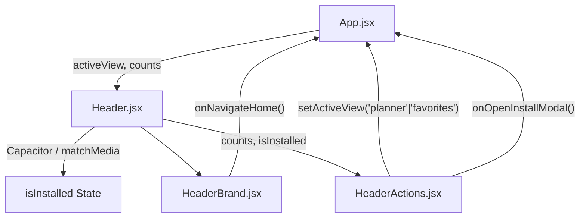

# Módulo Header (`src/components/header`)

Este módulo implementa la barra de cabecera superior persistente de la aplicación *Dragonwilds*.

---

## Arquitectura y Componentes

| Archivo | Líneas aprox. | Responsabilidad | Props |
| :--- | :---: | :--- | :--- |
| **`Header.jsx`** | ~75 | **Contenedor / Orquestador Principal**. Detecta el entorno nativo o PWA (`standalone`), gestiona el estado `isInstalled` y ensambla la marca y las acciones. | `activeView`, `setActiveView`, `favoritesCount`, `plannerCount`, `onOpenInstallModal` |
| **`HeaderBrand.jsx`** | ~20 | **Logotipo e identidad**. Renderiza el icono oficial, título de la aplicación y gestiona el clic para volver al inicio. | `onNavigateHome` (Function) |
| **`HeaderActions.jsx`** | ~45 | **Botones de acción rápida**. Accesos directos para la lista de Crafteo, Favoritos (con badges numéricos) y botón de instalación PWA. | `activeView`, `setActiveView`, `favoritesCount`, `plannerCount`, `isInstalled`, `onOpenInstallModal` |

---

## Flujo de Estados



## Uso

```jsx
import Header from './components/header/Header';

export default function App() {
  return (
    <Header
      activeView={activeView}
      setActiveView={setActiveView}
      favoritesCount={favorites.length}
      plannerCount={plannerItems.length}
      onOpenInstallModal={() => setIsModalOpen(true)}
    />
  );
}
```
