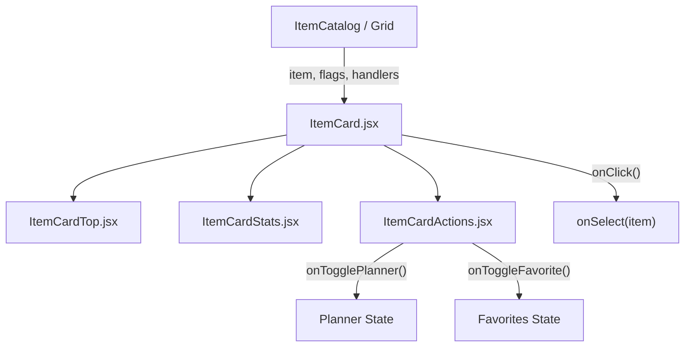

# Módulo Item Card (`src/components/itemCard`)

Este módulo implementa la tarjeta visual interactiva para ítems del catálogo, inventario y buscador de *Dragonwilds*.

---

## Arquitectura y Componentes

| Archivo | Líneas aprox. | Responsabilidad | Props |
| :--- | :---: | :--- | :--- |
| **`ItemCard.jsx`** | ~35 | **Contenedor / Orquestador Principal**. Gestiona el clic en la tarjeta (`onSelect`) y compone la cabecera, descripción, estadísticas y botones de acción. | `item`, `onSelect`, `isFavorite`, `onToggleFavorite`, `isInPlanner`, `onTogglePlanner` |
| **`ItemCardTop.jsx`** | ~45 | **Cabecera de la tarjeta**. Muestra el marco de icono con fallback de error de imagen, título truncado con tooltip, nivel de poder y tipo de objeto. | `item` (Object) |
| **`ItemCardStats.jsx`** | ~35 | **Píldoras de atributos**. Renderiza iconos y valores para Daño, Armadura, Bloqueo, Durabilidad y estación de Crafteo requerida. | `stats` (Object), `recipe` (Object) |
| **`ItemCardActions.jsx`** | ~40 | **Acciones interactivas**. Botón para añadir/quitar de la lista de crafteo, alternar favorito y botón explícito "Ver Ficha" con parada de propagación de eventos (`e.stopPropagation()`). | `item`, `isFavorite`, `onToggleFavorite`, `isInPlanner`, `onTogglePlanner`, `onSelect` |

---

## Flujo de Eventos



## Uso

```jsx
import ItemCard from './components/itemCard/ItemCard';

<ItemCard
  item={item}
  onSelect={(it) => setSelectedItem(it)}
  isFavorite={isFavorite}
  onToggleFavorite={handleToggleFavorite}
  isInPlanner={isInPlanner}
  onTogglePlanner={handleTogglePlanner}
/>
```
