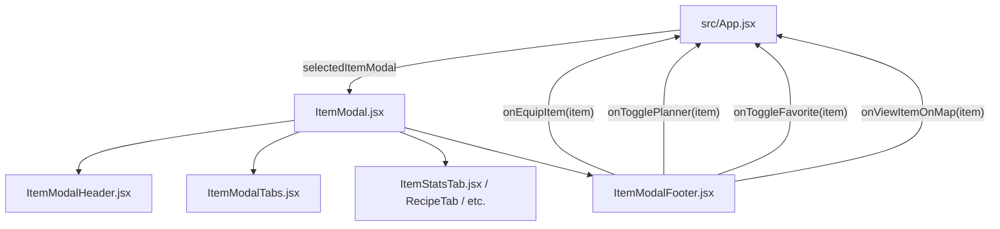

# Módulo Item Modal (`src/components/itemModal`)

Este módulo proporciona el modal interactivo de ficha técnica completa de cualquier objeto de *RuneScape: Dragonwilds*, con navegación por pestañas para consultar atributos, recetas de forja, ingredientes, ascensión mística y crónicas del códice.

---

## Arquitectura y Componentes

| Archivo | Líneas aprox. | Responsabilidad | Props |
| :--- | :---: | :--- | :--- |
| **`ItemModal.jsx`** | ~75 | **Contenedor / Orquestador Principal**. Gestiona el estado de pestaña activa (`activeTab`), calcula disponibilidad de pestañas condicionales y compone los submódulos. | `item`, `onClose`, `onSelectOtherItem`, `isFavorite`, `onToggleFavorite`, `isInPlanner`, `onTogglePlanner`, `onEquipItem`, `onViewItemOnMap` |
| **`ItemModalHeader.jsx`** | ~45 | **Cabecera del modal**. Marco de icono con fallback, título, cresta de poder, badges de categoría y botón de cierre (`X`). | `item`, `onClose`, `getPowerTierClass` |
| **`ItemModalTabs.jsx`** | ~55 | **Barra de navegación interna**. Pestañas con iconos RPG para Estadísticas, Receta, Usado en, Mejoras y Diario. | `activeTab`, `setActiveTab`, `hasRecipe`, `hasUsedIn`, `usedInCount`, `hasUpgrades`, `hasJournal` |
| **`ItemStatsTab.jsx`** | ~90 | **Pestaña de atributos de combate**. Grid de daño, tipo de daño, estilo de ataque, armadura, bloqueo, durabilidad, peso, costo de reparación y efectos especiales. | `item` |
| **`ItemRecipeTab.jsx`** | ~40 | **Pestaña de fabricación**. Estación de trabajo, habilidad y XP otorgada, y lista de materiales requeridos con navegación cruzada (`onSelectOtherItem`). | `recipe`, `onSelectOtherItem` |
| **`ItemUsedInTab.jsx`** | ~35 | **Pestaña de usos en crafteo**. Muestra en qué recetas se utiliza este objeto como material. | `usedIn`, `onSelectOtherItem` |
| **`ItemUpgradesTab.jsx`** | ~45 | **Pestaña de ascensión**. Tabla de niveles de poder, escalado de daño y núcleos requeridos en la Fragua Mística. | `upgrades` |
| **`ItemJournalTab.jsx`** | ~20 | **Pestaña de códice y lore**. Pergamino narrativo con la crónica de trasfondo del objeto en Ashenfall. | `journal` |
| **`ItemModalFooter.jsx`** | ~65 | **Barra de acciones**. Botones de Equipar, Añadir/Quitar de lista de crafteo, Favoritos, Ver en Mapa y enlace oficial a la Wiki. | `item`, `isFavorite`, `onToggleFavorite`, `isInPlanner`, `onTogglePlanner`, `onEquipItem`, `onViewItemOnMap` |

---

## Flujo de Datos



## Uso

```jsx
import ItemModal from './components/itemModal/ItemModal';

<ItemModal
  item={selectedItem}
  onClose={() => setSelectedItem(null)}
  onSelectOtherItem={(name) => handleSelectOther(name)}
  isFavorite={isFav}
  onToggleFavorite={handleToggleFav}
  isInPlanner={inPlanner}
  onTogglePlanner={handleTogglePlanner}
  onEquipItem={handleEquip}
  onViewItemOnMap={handleViewMap}
/>
```
