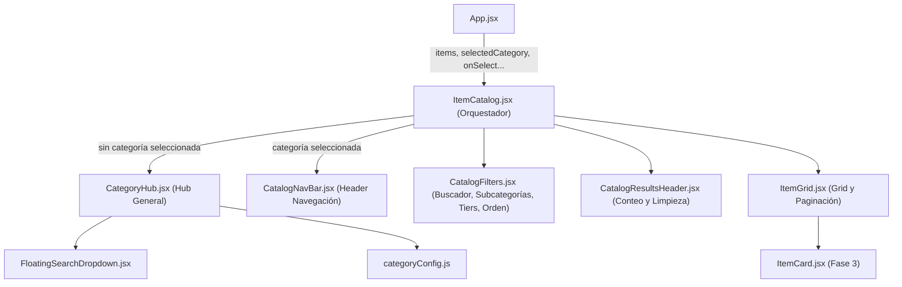

# Módulo Items (`src/components/items/`)

Módulo modularizado y atomizado para el catálogo y explorador de objetos de **Dragonwilds**. Administra el filtrado multifacético, búsqueda predictiva con desplegable flotante, agrupación por categorías y subcategorías, niveles de poder (Tiers 1 al 9), ordenamiento y paginación progresiva.

---

## 📐 Arquitectura del Módulo

---

## 📁 Submódulos y Componentes

| Archivo | Responsabilidad Principal | Líneas |
|---|---|:---:|
| **`categoryConfig.js`** | Diccionarios estáticos de categorías (`CATEGORY_DEFINITIONS`) y subcategorías con keywords e iconos (`SUBCATEGORIES_CONFIG`). | ~135 |
| **`CategoryHub.jsx`** | Vista de cuadrícula de categorías cuando no hay categoría seleccionada, incluye buscador predictivo flotante y tarjetas con contadores. | ~114 |
| **`CatalogNavBar.jsx`** | Barra superior con botón para retroceder al Hub, badge de categoría activa, título y total de objetos disponibles. | ~49 |
| **`CatalogFilters.jsx`** | Barra de búsqueda reactiva directa, selector de chips de subcategorías, filtro rápido de Tiers de Poder (T1-9) y menú desplegable de ordenamiento. | ~144 |
| **`CatalogResultsHeader.jsx`** | Contador de resultados visibles vs totales y botón condicional de "Limpiar Filtros". | ~28 |
| **`ItemGrid.jsx`** | Cuadrícula con las tarjetas individuales `ItemCard`, estado vacío con icono de llama y botón "Cargar Más Objetos (+48)". | ~56 |
| **`ItemCatalog.jsx`** | Orquestador principal de estado, cálculo de conteos, filtros con memoización y renderizado condicional del Hub o Catálogo. | ~238 |

---

## 🔌 Especificación de Props (`ItemCatalog.jsx`)

| Prop | Tipo | Requerido | Descripción |
|---|---|:---:|---|
| `items` | `Array<Object>` | Sí | Lista completa de ítems de la base de datos de Dragonwilds. |
| `selectedCategory` | `String \| null` | Sí | Categoría seleccionada actual (`'All'`, `'Armas de Combate'`, etc., o `null` para Hub). |
| `setSelectedCategory` | `Function` | Sí | Callback para actualizar la categoría activa o volver al Hub. |
| `onSelectItem` | `Function` | Sí | Callback ejecutado al hacer clic en un ítem para abrir su modal de detalle. |
| `favorites` | `Array<Object>` | Sí | Colección de ítems marcados como favoritos por el usuario. |
| `onToggleFavorite` | `Function` | Sí | Alterna el estado de favorito de un ítem. |
| `plannerItems` | `Array<Object>` | Sí | Colección de ítems añadidos al planificador de crafteo. |
| `onTogglePlanner` | `Function` | Sí | Alterna la presencia de un ítem en el planificador. |

---

## ⚡ Optimizaciones y Buenas Prácticas
1. **Memoización Robusta (`useMemo`):** Los cálculos de conteo por categoría, filtrado por subcategoría/keywords, búsqueda textual y ordenamiento se memoizan de forma independiente para mantener una respuesta fluida con más de 1,100 objetos.
2. **Carga Progresiva / Lazy Slicing:** Renderiza bloques de 48 objetos a la vez para mantener el DOM liviano y asegurar 60 FPS en dispositivos móviles y de baja potencia.
3. **Persistencia y Retrocompatibilidad:** El archivo raíz `src/components/ItemCatalog.jsx` reexporta directamente este módulo para evitar romper rutas heredadas.
