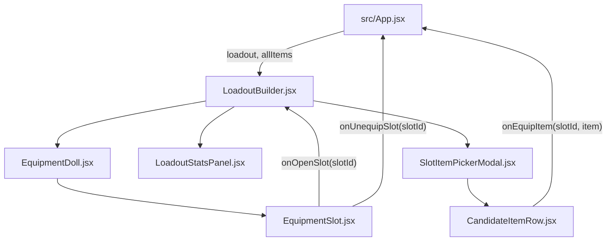

# Módulo Loadout Builder (`src/components/loadout`)

Este módulo implementa el Simulador de Personaje y Equipamiento de *RuneScape: Dragonwilds*, permitiendo probar combinaciones de armas, armaduras, amuletos y elixires, calculando en tiempo real las estadísticas combinadas del héroe.

---

## Arquitectura y Componentes

| Archivo | Líneas aprox. | Responsabilidad | Props |
| :--- | :---: | :--- | :--- |
| **`LoadoutBuilder.jsx`** | ~175 | **Contenedor / Orquestador Principal**. Gestiona el estado de la ranura seleccionada, calcula los totales acumulados (armadura, daño, peso, poder promedio) y ensambla los paneles. | `loadout`, `onEquipSlot`, `onUnequipSlot`, `onClearLoadout`, `allItems` |
| **`slotsConfig.js`** | ~125 | **Configuración de ranuras y palabras clave**. Define los 10 slots (cabeza, cuello, capa, torso, arma, escudo, piernas, anillo, consumibles 1 y 2) con sus filtros y subtipos en español e inglés. | Exporta `SLOTS_CONFIG` |
| **`EquipmentDoll.jsx`** | ~40 | **Muñeco / Escenario de ranuras**. Renderiza el grid de ranuras de equipamiento del personaje. | `slotsConfig`, `loadout`, `onOpenSlot`, `onUnequipSlot` |
| **`EquipmentSlot.jsx`** | ~50 | **Ranura individual interactiva**. Renderiza el icono temático o la imagen del objeto equipado con botón circular para desequipar (`X`). | `slot`, `item`, `onOpenSlot`, `onUnequipSlot` |
| **`LoadoutStatsPanel.jsx`** | ~80 | **Panel de estadísticas agregadas**. Tarjetas métricas de Nivel de Poder Promedio, Daño de Arma, Armadura Total, Bloqueo Combinado y Peso total del equipo con consejos de combate. | `totals` (Object) |
| **`SlotItemPickerModal.jsx`** | ~150 | **Modal selector de equipamiento**. Buscador en tiempo real, chips de subtipos específicos por ranura y filtros rápidos por tier de poder (T1-3, T4-6, T7, T8-9). | `activeSlotConfig`, `onClose`, `slotCandidates`, `modalSearch`, `setModalSearch`, `modalSubtype`, `setModalSubtype`, `modalPowerTier`, `setModalPowerTier`, `onEquipItem` |
| **`CandidateItemRow.jsx`** | ~42 | **Fila interactiva de objeto candidato**. Tarjeta compacta con icono, nivel de poder, resumen de daño/defensa y botón directo "Equipar". | `item`, `onEquip` |

---

## Flujo de Datos



## Uso

```jsx
import LoadoutBuilder from './components/loadout/LoadoutBuilder';

<LoadoutBuilder
  loadout={loadout}
  onEquipSlot={(slotId, item) => handleEquip(slotId, item)}
  onUnequipSlot={(slotId) => handleUnequip(slotId)}
  onClearLoadout={() => setLoadout({})}
  allItems={itemsData}
/>
```
