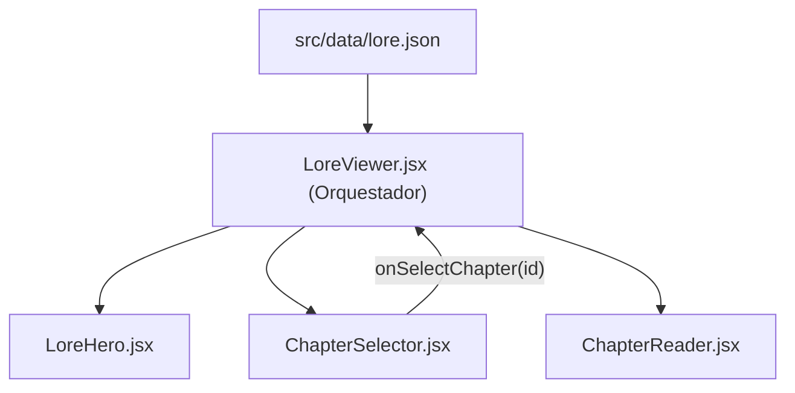

# Módulo Lore Viewer (`src/components/lore`)

Este módulo proporciona la vista del Códice, Crónicas y Trasfondo histórico de *RuneScape: Dragonwilds*.

---

## Arquitectura y Componentes

| Archivo | Líneas aprox. | Responsabilidad | Props |
| :--- | :---: | :--- | :--- |
| **`LoreViewer.jsx`** | ~28 | **Contenedor / Orquestador Principal**. Gestiona el estado del capítulo seleccionado (`activeChapterId`) y ensambla el hero, el selector y el lector. | Ninguna |
| **`LoreHero.jsx`** | ~32 | **Cabecera temática**. Presenta el título general de las crónicas y la introducción general cargada desde `lore.json`. | `title` (String), `intro` (String) |
| **`ChapterSelector.jsx`** | ~56 | **Navegación de capítulos**. Lista lateral con botones accesibles, iconos de juego, categorías y estados visuales activos. | `chapters` (Array), `activeChapterId` (String), `onSelectChapter` (Function) |
| **`ChapterReader.jsx`** | ~54 | **Lector en pergamino**. Despliega la cita, categoría, título, resumen destacado y texto completo del capítulo seleccionado. | `activeChapter` (Object) |

---

## Flujo de Datos



## Uso

```jsx
import LoreViewer from './components/lore/LoreViewer';

export default function App() {
  return <LoreViewer />;
}
```
