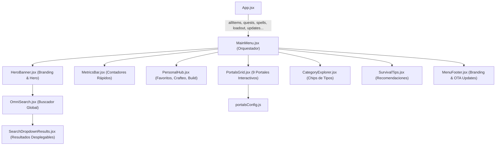

# Módulo MainMenu (`src/components/mainMenu/`)

Módulo modularizado y atomizado para el panel principal y centro de mandos de **RuneScape: Dragonwilds Companion**. Centraliza la búsqueda global omnidireccional (Omni-Search), métricas del compendio, seguimiento del progreso del jugador, accesos directos a los 9 portales de la app, filtros por categorías de objetos, consejos de supervivencia y comprobación de actualizaciones OTA para Android.

---

## 📐 Arquitectura del Módulo

---

## 📁 Submódulos y Componentes

| Archivo | Responsabilidad Principal | Líneas |
|---|---|:---:|
| **`portalsConfig.js`** | Generador de configuración de los 9 portales principales con títulos, tags, iconos, colores y callbacks de navegación. | ~110 |
| **`SearchDropdownResults.jsx`** | Desplegable de resultados de búsqueda agrupados (Ítems, Bóvedas, Quests, Hechizos y POIs del mapa) con estado vacío y botón al catálogo. | ~130 |
| **`OmniSearch.jsx`** | Barra de búsqueda omnidireccional reactiva con filtrado multientidad y gestión de foco. | ~90 |
| **`HeroBanner.jsx`** | Sección hero de cabecera con orbe de iluminación decorativo, título principal y caja de OmniSearch. | ~40 |
| **`MetricsBar.jsx`** | Fila de métricas interactivas con conteos globales de objetos, misiones, hechizos y exploración del mapa. | ~55 |
| **`PersonalHub.jsx`** | Panel personalizado del usuario con accesos directos a favoritos guardados, recetas en lista de crafteo y ranuras equipadas. | ~100 |
| **`PortalsGrid.jsx`** | Cuadrícula de 9 tarjetas interactivas ("portal-card") con efectos hover, glow perimetral y redirección de vistas. | ~65 |
| **`CategoryExplorer.jsx`** | Accesos rápidos para explorar el Códice filtrando directamente por tipo de objeto (Armas, Armaduras, Consumibles, etc.). | ~45 |
| **`SurvivalTips.jsx`** | Tarjetas informativas con consejos de viaje rápido, crafteo en masa y preparación de combates. | ~48 |
| **`MenuFooter.jsx`** | Pie de página con copyright, versión actual, comprobador de actualizaciones GitHub y botón de descarga OTA en Capacitor. | ~80 |
| **`MainMenu.jsx`** | Contenedor orquestador que ensambla todos los submódulos y distribuye las propiedades recibidas. | ~85 |

---

## 🔌 Especificación de Props (`MainMenu.jsx`)

| Prop | Tipo | Por Defecto | Descripción |
|---|---|:---:|---|
| `setActiveView` | `Function` | Requerido | Callback para alternar entre las vistas principales de la aplicación. |
| `setSelectedCategory` | `Function` | Requerido | Callback para preseleccionar una categoría de ítems al navegar al catálogo. |
| `onSelectItem` | `Function` | Requerido | Callback para abrir el modal de detalle de un ítem seleccionado en la búsqueda. |
| `onSelectVault` | `Function` | `() => {}` | Callback para abrir la guía detallada de una bóveda desde el OmniSearch. |
| `favorites` | `Array<Object>` | `[]` | Lista de ítems marcados como favoritos. |
| `plannerItems` | `Array<Object>` | `[]` | Lista de ítems en la calculadora de crafteo. |
| `loadout` | `Object` | `{}` | Diccionario de ranuras de equipamiento del simulador. |
| `allItems` | `Array<Object>` | `[]` | Catálogo completo de ítems para el buscador y contadores. |
| `quests` | `Array<Object>` | `[]` | Colección de misiones para el buscador y contadores. |
| `spells` | `Array<Object>` | `[]` | Colección de hechizos para el buscador y contadores. |
| `onViewQuestOnMap` | `Function` | Opcional | Callback para ubicar misiones en el mapa interactivo. |
| `onCheckForUpdates` | `Function` | `() => {}` | Disparador de verificación de nuevas versiones en GitHub. |
| `isCheckingUpdate` | `Boolean` | `false` | Estado de carga mientras se consulta la API de GitHub Releases. |
| `updateInfo` | `Object \| null` | `null` | Información de release disponible (`hasUpdate`, `latestVersion`, etc.). |
| `updateCheckMessage` | `String \| null` | `null` | Mensaje de feedback tras la comprobación de actualización. |
| `onOpenUpdateModal` | `Function` | `() => {}` | Abre el modal de descarga e instalación OTA. |

---

## ⚡ Optimizaciones y Buenas Prácticas
1. **OmniSearch Desacoplado:** La lógica de búsqueda multientidad se encuentra aislada en `OmniSearch.jsx`, procesando de manera simultánea 5 fuentes de datos distintas sin bloquear el renderizado del menú.
2. **Modularización de Portales:** Toda la configuración visual y descriptiva de las tarjetas se maneja de forma centralizada en `portalsConfig.js`, permitiendo añadir futuros portales sin alterar la estructura JSX.
3. **Soporte Nativo Multiplataforma:** `MenuFooter.jsx` detecta automáticamente si la aplicación se ejecuta en navegador web o empaquetada como APK nativa mediante Capacitor, mostrando condicionalmente la versión y el actualizador OTA.
4. **Retrocompatibilidad:** Re-export en `src/components/MainMenu.jsx` para garantizar compatibilidad con importaciones previas.
