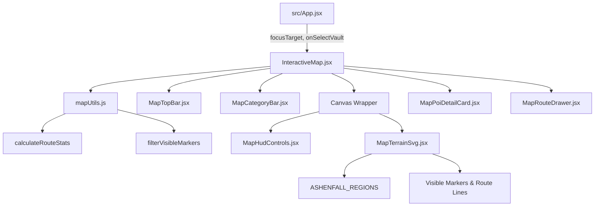

# Módulo del Mapa Interactivo y Planificador de Rutas (`src/components/map/`)

Módulo modularizado y desacoplado para el **Mapa Cartográfico y de Satélite Interactivo de Ashenfall** de **Dragonwilds**. Ofrece un motor vectorial SVG de alto rendimiento con zoom fluido, paneo táctil y de ratón, HUD de coordenadas en tiempo real, trazado de rutas de farmeo animadas con cálculo de distancia métrica/tiempo estimado, filtros multicategoría y visor de puntos de interés (POIs).

---

## 1. Arquitectura y Responsabilidades

```
src/components/map/
├── InteractiveMap.jsx       # Orquestador principal (viewport, transformaciones, drag/touch, sincronización)
├── mapConstants.js          # Constantes de categorías (CATEGORY_META), claves de localStorage y factores de escala
├── mapUtils.js              # Algoritmos puros: cálculo de distancias métricas, tiempo estimado, filtros y badges
├── MapTopBar.jsx            # Cabecera superior con título, buscador rápido y botón de alternancia de ruta
├── MapCategoryBar.jsx       # Barra horizontal con pills de filtrado por categoría y contadores dinámicos
├── MapHudControls.jsx       # HUD flotante: coordenadas X/Y, controles de zoom/paneo, rosa de los vientos y capas
├── MapTerrainSvg.jsx        # Lienzo SVG 1024x1024: capas de satélite/pergamino, regiones, rutas y marcadores
├── MapPoiDetailCard.jsx     # Ficha modal flotante del punto seleccionado (imagen, botín, materiales, bóveda y ruta)
├── MapRouteDrawer.jsx       # Panel lateral de ruta activa: métricas (km/min), waypoints, rutas predefinidas y guardado
└── README.md                # Documentación técnica del módulo
```

---

## 2. Mapa de Componentes y Props

### `InteractiveMap.jsx` (Orquestador)
Contenedor principal que administra la matriz de transformación del mapa (`zoom`, `pan`), eventos de arrastre y táctiles (pinch-to-zoom), persistencia en `localStorage` y enfoque externo automático.

| Prop | Tipo | Descripción |
| :--- | :--- | :--- |
| `focusTarget` | `Object \| null` | Objeto con coordenadas `{ coords: { x, y } }` o material `{ materialName }` para centrado y trazado automático. |
| `onClearFocus` | `Function()` | Callback al limpiar el foco externo. |
| `onSelectQuest` | `Function(questId: string)` | Callback para abrir el detalle de una misión. |
| `onSelectItem` | `Function(item: Object)` | Callback para abrir la ficha de un objeto en el catálogo. |
| `onSelectVault` | `Function(vaultId: string)` | Callback para abrir la guía completa de una Bóveda Dragonkin. |

---

### `mapUtils.js` y `mapConstants.js`
Lógica matemática pura y constantes:
- **`calculateRouteStats(activeWaypoints)`**: Suma distancias euclidianas entre waypoints consecutivos y las convierte a metros de juego reales ($1\text{ px} \approx 4.2\text{ m}$) y tiempo estimado de viaje corriendo a $4.5\text{ m/s}$ ($260\text{ m/min}$).
- **`filterVisibleMarkers(allMarkers, category, query)`**: Filtrado insensible a acentos ni mayúsculas (`normalizeText`) sobre nombres, regiones, descripciones y botín.
- **`calculateCategoryCounts(allMarkers, customMarkers, mapMarkers)`**: Agrupación reactiva de contadores de marcadores.

---

### `MapTerrainSvg.jsx` (Motor Visual SVG)
Lienzo vectorial interactivo escalado a 1024x1024 px:
- **Capa Satélite**: Textura oficial en alta resolución (`/map/ashenfall-full.jpg`) con cuadrícula de fantasía semiopaca.
- **Capa Cartográfica / Pergamino**: Gradientes vectoriales de atmósfera por bioma, masa continental de Ashenfall, ríos y senderos ancestrales.
- **Capa de Regiones**: Textos con cálculo multilínea, nombre, nivel de peligro y Tier.
- **Capa de Rutas**: Polilínea luminosa con animación continua de trazo discontinuo (`routeDashFlow`).
- **Capa de Marcadores y POIs**: Círculos con anillo de pulso animado (`markerPulse`), etiquetas de hover e índices secuenciales de ruta.

---

### `MapRouteDrawer.jsx` (Planificador de Rutas)
Panel interactivo con lista de paradas:
- Resumen métrico: Distancia total (km), tiempo estimado (~min) y número de paradas.
- Lista reordenable (subir/bajar), marcado de check de completado persistido en `localStorage`, centrado de cámara y borrado.
- Acceso a rutas recomendadas (`PRESET_ROUTES`) y biblioteca de rutas guardadas por el usuario.

---

## 3. Diagrama de Flujo de Datos


