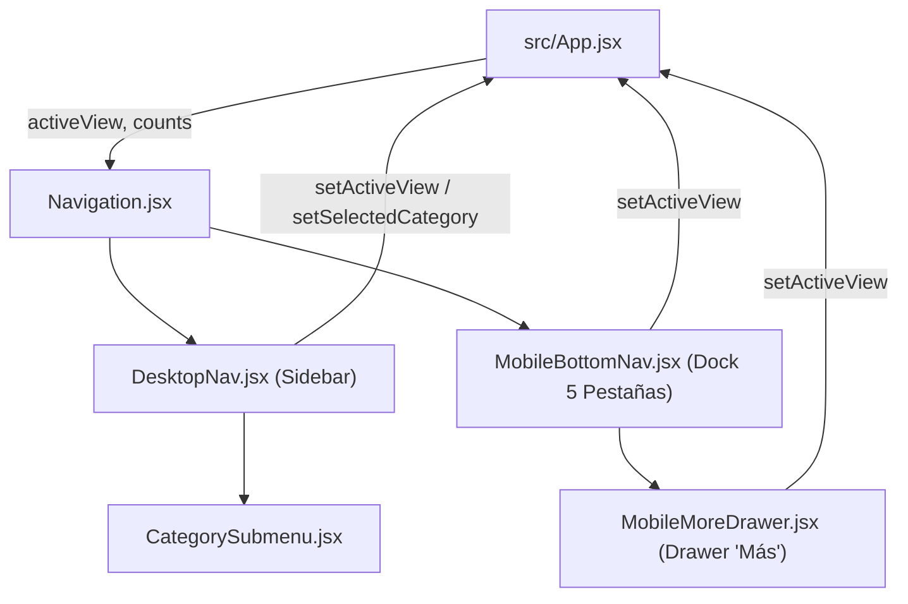

# Módulo Navigation (`src/components/navigation`)

Este módulo proporciona el sistema de navegación adaptativo de *RuneScape: Dragonwilds*, ofreciendo una barra lateral colapsable para ordenadores y tablets, y un dock inferior flotante de 5 pestañas con drawer emergente para dispositivos móviles.

---

## Arquitectura y Componentes

| Archivo | Líneas aprox. | Responsabilidad | Props |
| :--- | :---: | :--- | :--- |
| **`Navigation.jsx`** | ~36 | **Contenedor / Orquestador Principal**. Distribuye el estado y eventos entre la navegación de escritorio (`DesktopNav`) y la móvil (`MobileBottomNav`). | `activeView`, `setActiveView`, `selectedCategory`, `setSelectedCategory`, `categoryCounts`, `questCount`, `spellCount` |
| **`DesktopNav.jsx`** | ~145 | **Sidebar de escritorio y tablet**. Agrupa las secciones de contenido/crónicas y herramientas de héroe con badges numéricos y selector colapsable de categorías de ítems. | Mismas props que `Navigation` |
| **`CategorySubmenu.jsx`** | ~35 | **Submenú desplegable de ítems**. Lista vertical interactiva con iconos temáticos y contadores en tiempo real por cada categoría de objetos. | `categories`, `categoryCounts`, `activeView`, `selectedCategory`, `onSelectCategory` |
| **`MobileBottomNav.jsx`** | ~75 | **Dock inferior fijo (5 pestañas)**. Botones táctiles optimizados (Ítems, Misiones, Mapa, Más) y botón central flotante elevado para volver a Inicio (`home`). | `activeView`, `setActiveView`, `setSelectedCategory` |
| **`MobileMoreDrawer.jsx`** | ~95 | **Drawer inferior emergente ("Más")**. Menú deslizable con accesos directos al resto de herramientas (Bóvedas, Grimorio, Simulador, Crafteo, Habilidades, Códice, Favoritos). | `activeView`, `setActiveView`, `onClose` |

---

## Flujo de Navegación



## Uso

```jsx
import Navigation from './components/navigation/Navigation';

export default function App() {
  return (
    <Navigation
      activeView={activeView}
      setActiveView={setActiveView}
      selectedCategory={selectedCategory}
      setSelectedCategory={setSelectedCategory}
      categoryCounts={categoryCounts}
      questCount={questsData.length}
      spellCount={spellsData.length}
    />
  );
}
```
