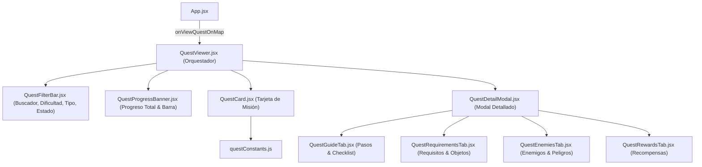

# Módulo Quests (`src/components/quests/`)

Módulo modularizado y atomizado para el **Diario de Misiones y Aventuras de Ashenfall** de **Dragonwilds**. Ofrece seguimiento de 39 misiones traducidas al español, con buscador predictivo por lemas (`getWordStems`), filtros por dificultad, tipo y estado de progreso persistente en `localStorage`, lista interactiva de verificación de pasos (walkthrough checklist), y visualización modal con pestañas de requisitos, enemigos y recompensas.

---

## 📐 Arquitectura del Módulo

---

## 📁 Submódulos y Componentes

| Archivo | Responsabilidad Principal | Líneas |
|---|---|:---:|
| **`questConstants.js`** | Diccionario de colores, fondos y bordes por nivel de dificultad (`DIFFICULTY_COLORS`). | ~8 |
| **`QuestFilterBar.jsx`** | Barra de búsqueda con limpieza rápida, selectores por dificultad (Principiante a Gran Maestra), tipo (Principal/Secundaria) y estado con contadores. | ~100 |
| **`QuestProgressBanner.jsx`** | Banner de estado con medidor visual de progreso acumulado y porcentaje de misiones completadas. | ~45 |
| **`QuestCard.jsx`** | Ficha de misión en la cuadrícula con badges de tipo y dificultad, botón de alternancia de estado (Pendiente, En Curso, Completada), punto de inicio, objetos requeridos y botones a la guía y mapa. | ~130 |
| **`QuestGuideTab.jsx`** | Pestaña de guía con sinopsis y checklist interactivo paso a paso persistido en `localStorage`. | ~85 |
| **`QuestRequirementsTab.jsx`** | Pestaña con requisitos previos, lista de objetos obligatorios y lista de objetos recomendados. | ~65 |
| **`QuestEnemiesTab.jsx`** | Pestaña con listado de enemigos, jefes y amenazas a enfrentar durante la misión. | ~25 |
| **`QuestRewardsTab.jsx`** | Pestaña con recompensas de experiencia, ítems y desbloqueos por completar la misión. | ~25 |
| **`QuestDetailModal.jsx`** | Ventana modal con cabecera informativa, barra de pestañas, punto de inicio siempre visible, cuerpo dinámico y acciones inferiores. | ~135 |
| **`QuestViewer.jsx`** | Orquestador principal de estado, persistencia en `localStorage`, filtrado inteligente en español y gestión del modal. | ~140 |

---

## 🔌 Especificación de Props (`QuestViewer.jsx`)

| Prop | Tipo | Por Defecto | Descripción |
|---|---|:---:|---|
| `onViewQuestOnMap` | `Function` | Opcional | Callback ejecutado para enfocar el punto de inicio de la misión en el mapa interactivo y trazar ruta. |

---

## ⚡ Optimizaciones y Buenas Prácticas
1. **Persistencia Dual en `localStorage`:** Almacena el estado de cada misión (`rs_dw_quest_progress`) y el estado individual de cada paso del checklist (`rs_dw_quest_checked_steps`) para que el progreso no se pierda al recargar la app.
2. **Búsqueda Inteligente en Español con Stemming:** Emplea `normalizeText` y `getWordStems` para hacer coincidencias flexibles de palabras en nombres, títulos en inglés, descripciones, lugares y requisitos.
3. **Pestañas Condicionales:** La pestaña de enemigos solo se renderiza si la misión actual contiene entradas en `quest.enemies`.
4. **Retrocompatibilidad:** Re-export en `src/components/QuestViewer.jsx` para garantizar resolución de rutas heredadas.
