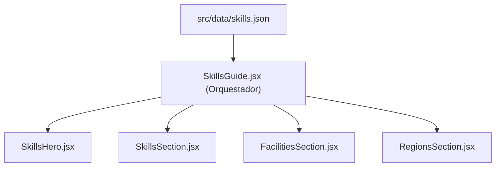

# Módulo Skills Guide (`src/components/skills`)

Este módulo proporciona la vista completa de la Guía de Habilidades, Estaciones de Trabajo y Regiones de Ashenfall en *RuneScape: Dragonwilds*.

---

## Arquitectura y Componentes

| Archivo | Líneas aprox. | Responsabilidad | Props |
| :--- | :---: | :--- | :--- |
| **`SkillsGuide.jsx`** | ~28 | **Contenedor / Orquestador Principal**. Carga los datos desde `src/data/skills.json` y compone las cuatro secciones visuales. | Ninguna |
| **`SkillsHero.jsx`** | ~18 | **Cabecera informativa**. Muestra el banner temático introductorio con título, icono y contexto de supervivencia en Ashenfall. | Ninguna |
| **`SkillsSection.jsx`** | ~55 | **Rejilla de habilidades**. Renderiza el listado de las 8 disciplinas con sus descripciones, tomos requeridos y consejos prácticos. | `skills` (Array): Lista de habilidades |
| **`FacilitiesSection.jsx`** | ~42 | **Estaciones de crafteo**. Presenta las forjas, yunques y puestos de trabajo necesarios para elaborar equipamiento. | `facilities` (Array): Lista de estaciones |
| **`RegionsSection.jsx`** | ~42 | **Regiones y zonas de peligro**. Detalla las áreas geográficas de Ashenfall junto con sus niveles de amenaza. | `regions` (Array): Lista de regiones |

---

## Flujo de Datos



## Uso

```jsx
import SkillsGuide from './components/skills/SkillsGuide';

export default function App() {
  return <SkillsGuide />;
}
```
