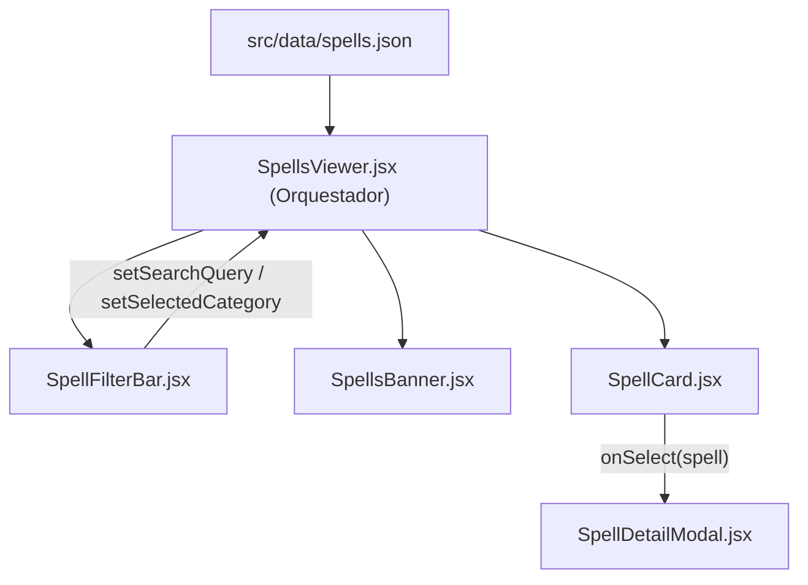

# Módulo Spells Viewer (`src/components/spells`)

Este módulo proporciona el catálogo y visor del Grimorio Arcano de *RuneScape: Dragonwilds*, permitiendo filtrar hechizos por escuela elemental, buscar por nombre o runas, y consultar sus costes de lanzamiento.

---

## Arquitectura y Componentes

| Archivo | Líneas aprox. | Responsabilidad | Props |
| :--- | :---: | :--- | :--- |
| **`SpellsViewer.jsx`** | ~110 | **Contenedor / Orquestador Principal**. Gestiona el estado de filtros (`selectedCategory`, `searchQuery`), filtra la lista con `normalizeText`/`getWordStems`, y orquesta la apertura del modal. | Ninguna |
| **`SpellFilterBar.jsx`** | ~48 | **Barra de búsqueda y categorías**. Input de búsqueda con botón de limpieza y chips de categorías mágicas con iconos temáticos. | `searchQuery`, `setSearchQuery`, `selectedCategory`, `setSelectedCategory`, `categories` |
| **`SpellsBanner.jsx`** | ~32 | **Cabecera informativa**. Muestra el lema del Grimorio Arcano y el contador de hechizos filtrados frente al total. | `filteredCount` (Number), `totalCount` (Number) |
| **`SpellCard.jsx`** | ~120 | **Tarjeta de hechizo**. Renderiza el icono con fallback remoto, nombre, nivel de magia requerido, efecto resumido y lista de runas necesarias. | `spell` (Object), `onSelect` (Function) |
| **`SpellDetailModal.jsx`** | ~104 | **Modal de detalle**. Vista emergente con efecto detallado, desglose de unidades de runas requeridas y enlace a la wiki oficial. | `spell` (Object), `onClose` (Function) |

---

## Flujo de Datos



## Uso

```jsx
import SpellsViewer from './components/spells/SpellsViewer';

export default function App() {
  return <SpellsViewer />;
}
```
