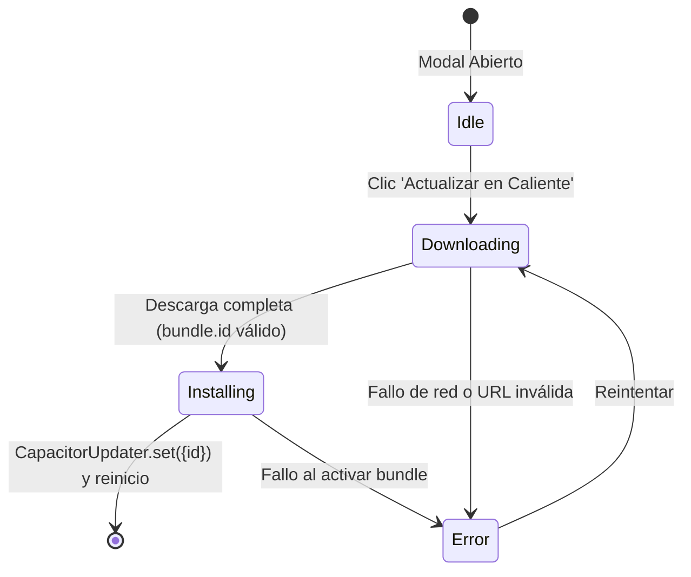

# Módulo Update Modal (`src/components/update`)

Este módulo proporciona el modal de notificación e instalación de actualizaciones de *RuneScape: Dragonwilds*, con soporte para descargas OTA en caliente (Over-The-Air) mediante `@capgo/capacitor-updater` y descarga manual de APK.

---

## Arquitectura y Componentes

| Archivo | Líneas aprox. | Responsabilidad | Props |
| :--- | :---: | :--- | :--- |
| **`UpdateModal.jsx`** | ~140 | **Contenedor / Orquestador Principal**. Gestiona la máquina de estados (`idle`, `downloading`, `installing`, `error`), el listener de progreso de CapacitorUpdater y los fallbacks de descarga directa. | `isOpen`, `onClose`, `updateInfo`, `onDismiss` |
| **`UpdateHeader.jsx`** | ~35 | **Cabecera del modal**. Icono de cohete espacial decorativo, título de actualización y botón de cerrar condicional (deshabilitado mientras descarga). | `onClose`, `canClose` |
| **`UpdateVersionBanner.jsx`** | ~55 | **Comparador de versiones**. Muestra `vActual` -> `vDisponible`, insignia verde de disponibilidad, fecha de publicación y tamaño del paquete OTA / APK. | `currentVersion`, `latestVersion`, `publishedAt`, `zipFileSize`, `apkFileSize`, `apkFileName` |
| **`UpdateChangelog.jsx`** | ~55 | **Notas de versión**. Formateador de texto Markdown con cabeceras de sección, listas con viñetas estilizadas y contenedor con scroll. | `releaseName`, `releaseNotes` |
| **`UpdateProgress.jsx`** | ~90 | **Indicadores de progreso y estado**. Muestra barra de progreso animada durante la descarga, spinner de instalación, alerta de error o nota informativa de conservación de datos. | `status`, `downloadPercent`, `errorMessage`, `isNative`, `hasOtaZip` |
| **`UpdateFooter.jsx`** | ~65 | **Botonera de acción**. Botón "Recordar más tarde", enlace a la release en GitHub, botón "Actualizar en Caliente" (OTA instantáneo) o descarga manual de APK. | `status`, `isNative`, `hasOtaZip`, `zipDownloadUrl`, `hasDirectApk`, `releaseUrl`, `onDismissLater`, `onOtaUpdate`, `onManualApkDownload` |

---

## Flujo de Estados OTA



## Uso

```jsx
import UpdateModal from './components/update/UpdateModal';

<UpdateModal
  isOpen={isUpdateModalOpen}
  onClose={() => setIsUpdateModalOpen(false)}
  updateInfo={updateInfo}
  onDismiss={() => setUpdateInfo(null)}
/>
```
