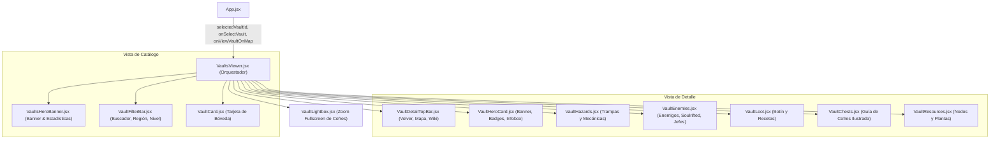

# Módulo Vaults (`src/components/vaults/`)

Módulo modularizado y atomizado para el explorador del **Códice Draconis: Cámaras y Bóvedas Dragonkin** de **Dragonwilds**. Permite explorar las 12 bóvedas ancestrales de Ashenfall, consultar guías paso a paso de resolución de trampas, tablas de enemigos estándar y de Reinos Espirituales, botín legendario, recetas de forja y localización ilustrada de cofres secretos con visor modal en pantalla completa (lightbox).

---

## 📐 Arquitectura del Módulo

---

## 📁 Submódulos y Componentes

| Archivo | Responsabilidad Principal | Líneas |
|---|---|:---:|
| **`vaultsConstants.js`** | Diccionario de colores, bordes y etiquetas para niveles de poder (`POWER_LEVEL_COLORS`). | ~10 |
| **`VaultsHeroBanner.jsx`** | Banner de presentación del Códice Draconis con barra de métricas (bóvedas, cofres, núcleos, recetas). | ~40 |
| **`VaultFilterBar.jsx`** | Filtro de búsqueda por texto normalizado (`normalizeText`), selector de región geográfica y selector de nivel de poder. | ~75 |
| **`VaultCard.jsx`** | Tarjeta de catálogo con banner de entrada, badges de nivel/cofres, resumen, chips de botín y accesos directos a guía y mapa. | ~105 |
| **`VaultDetailTopBar.jsx`** | Barra superior sticky con botón de retorno al índice, enlace a ubicación en mapa interactivo y wiki oficial. | ~45 |
| **`VaultHeroCard.jsx`** | Infobox temático con imagen de portada, niveles de peligro/poder, resumen histórico y métricas técnicas. | ~70 |
| **`VaultHazards.jsx`** | Listado estructurado de trampas y peligros de la cámara con tipos y mecánicas explicadas. | ~40 |
| **`VaultEnemies.jsx`** | Tabla de enemigos estándar con niveles y cantidades, tabla del Reino Espiritual (Soulrifted) y ficha de jefe/guardián élite. | ~105 |
| **`VaultLoot.jsx`** | Cuadrícula de botín notable y bloque de recetas de forja desbloqueables en efigies de Dragonkin. | ~65 |
| **`VaultChests.jsx`** | Guía detallada de cofres secretos e instrucciones de acceso, con miniaturas interactivas para ampliar. | ~75 |
| **`VaultResources.jsx`** | Desglose de recursos recolectables en el interior: yacimientos de minería, ventilas, plantas y objetos especiales. | ~65 |
| **`VaultLightbox.jsx`** | Visor modal en pantalla completa para inspeccionar capturas de pantalla de los cofres con zoom y descripción. | ~35 |
| **`VaultsViewer.jsx`** | Orquestador principal: gestión de estado de navegación, filtros memoizados y sincronización bidireccional con el mapa. | ~190 |

---

## 🔌 Especificación de Props (`VaultsViewer.jsx`)

| Prop | Tipo | Por Defecto | Descripción |
|---|---|:---:|---|
| `selectedVaultId` | `String \| null` | `null` | Identificador de la bóveda a pre-seleccionar (procedente por ejemplo de un clic en el mapa interactivo). |
| `onSelectVault` | `Function` | `() => {}` | Callback emitido al abrir o cerrar la guía de una bóveda. |
| `onViewVaultOnMap` | `Function` | `() => {}` | Callback para alternar a la vista del mapa interactivo y enfocar las coordenadas exactas de la bóveda. |
| `onSelectItem` | `Function` | `() => {}` | Callback opcional para abrir la ficha de un ítem mencionado en el botín. |

---

## ⚡ Optimizaciones y Buenas Prácticas
1. **Búsqueda Normalizada:** Uso de `normalizeText` para permitir coincidencias insensibles a mayúsculas, minúsculas y tildes en nombres de bóvedas, regiones, resúmenes, botines y recetas.
2. **Scroll Suave y Memoria Visual:** La navegación entre el índice y el detalle ejecuta scrolls inmediatos o suaves controlados para situar al jugador siempre al inicio de la información.
3. **Manejo de Errores en Imágenes:** Fallbacks automáticos mediante `onError` a iconos estándar de dungeon si una captura remota no estuviera disponible.
4. **Retrocompatibilidad:** Re-export en `src/components/VaultsViewer.jsx` para garantizar que las referencias legacy se resuelvan sin cambios en código externo.
